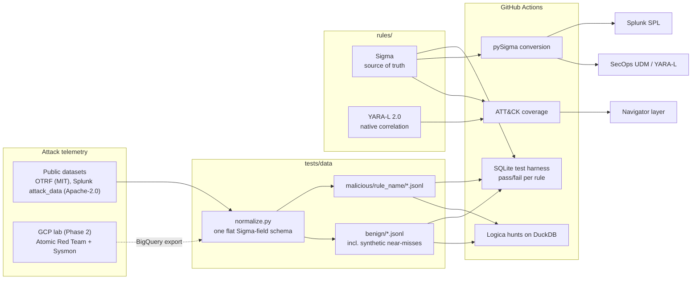
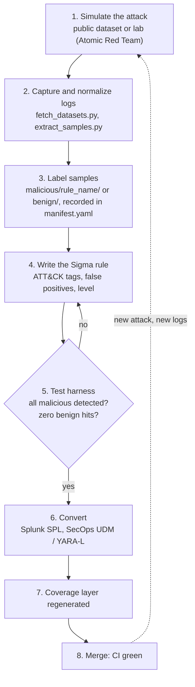

# Purple Loop

> **Purple Loop turns simulated attacks into tested, portable detections.**

[](https://github.com/aryandhuru49/Purple-Loop/actions/workflows/ci.yml)

Purple Loop is a detection-as-code repository. Attack telemetry goes in; detection rules
come out tested against labeled malicious and benign logs, converted to Splunk SPL and
Google SecOps, mapped onto MITRE ATT&CK, and checked on every commit by CI.

## The problem

Detections usually live inside a SIEM's web console: edited by hand, untested, and
tied to one vendor's query language. Nobody can say whether a rule still fires on the
attack it was written for, or how many false positives it will produce, until it does
(or doesn't) in production.

Detection as code treats rules like software:

- **Version controlled:** every rule change is a reviewed commit.
- **Tested:** each rule must detect its attack samples and stay quiet on benign activity, in CI.
- **Portable:** one Sigma source rule converts to several SIEM languages.
- **Measured:** ATT&CK coverage is generated from the rules, not maintained in a spreadsheet.

## Why "Purple Loop"

Red teams attack, blue teams detect; *purple* teaming joins them. The *loop* is the
automated cycle this repo builds: simulate an attack, capture its logs, write or fix a
detection, prove it with tests, and feed new attack logs back in as test cases.

## Architecture



## Rule lifecycle



## What's in it

| Component | Where | Status |
|---|---|---|
| 10 Sigma rules covering 11 ATT&CK techniques | [`rules/sigma/`](rules/sigma) | Tested in CI: **43/43 malicious events detected, 0 false positives** on 113 benign events |
| Test harness (pySigma SQLite backend) | [`scripts/sigma_harness.py`](scripts/sigma_harness.py) | Self-tested: proves it reports misses and false positives |
| Splunk SPL + `savedsearches.conf` | [`converted/splunk/`](converted/splunk) | 10/10 rules |
| Google SecOps UDM search / YARA-L | [`converted/secops/`](converted/secops) | Partial; see [conversion report](converted/CONVERSION_REPORT.md) |
| 3 native YARA-L 2.0 correlation rules | [`rules/yara_l/`](rules/yara_l) | Linted and reviewed, **not executed** |
| 3 Logica threat hunts (+ generated SQL) | [`hunts/logica/`](hunts/logica) | Run on DuckDB in CI |
| ATT&CK coverage | [`coverage/`](coverage) | [Table](coverage/COVERAGE.md) and [Navigator layer](coverage/attack_navigator_layer.json) |
| GCP attack lab (Terraform) | `infra/terraform/` | Phase 2 |

### ATT&CK coverage

The full table is generated in [coverage/COVERAGE.md](coverage/COVERAGE.md). To view the
heat map, open the [ATT&CK Navigator](https://mitre-attack.github.io/attack-navigator/),
choose **Open Existing Layer → Upload from local**, and select
[`coverage/attack_navigator_layer.json`](coverage/attack_navigator_layer.json).
Each technique's comment states which rules cover it and whether they are tested.

## Quick start

Requires Python 3.12 and [uv](https://docs.astral.sh/uv/).

```bash
git clone https://github.com/aryandhuru49/Purple-Loop.git
cd Purple-Loop
uv sync                                         # install pinned dependencies
uv run pre-commit install                       # lint + secret scan on every commit

uv run python scripts/run_sigma_tests.py        # pass/fail table for every Sigma rule
uv run pytest                                   # all tests
uv run python scripts/convert_rules.py          # regenerate converted/
uv run python scripts/run_hunts.py              # run Logica hunts on DuckDB
uv run python scripts/generate_coverage.py      # regenerate the ATT&CK layer

# Optional: rebuild the test samples from the original public datasets
uv run python scripts/fetch_datasets.py
uv run python scripts/extract_samples.py --check
```

To add a rule, follow [docs/rule_writing_guide.md](docs/rule_writing_guide.md).

## Known limitations

Stated plainly, because a detection repo that oversells itself is worse than none.

- **YARA-L is not executed.** Google SecOps is a paid platform. The native YARA-L rules are
  linted offline and reviewed; the Kerberoasting rule depends on UDM field mappings that are
  marked as assumptions. See [docs/yara_l.md](docs/yara_l.md).
- **SecOps conversion is partial.** The pySigma SecOps backend cannot map 4 of the 10 rules'
  fields to UDM, and its YARA-L output had precedence and naming bugs; affected output is
  flagged `DO NOT DEPLOY`. See [docs/conversion.md](docs/conversion.md).
- **Splunk SPL is not run against Splunk.** Detection logic is tested in SQLite with Sigma
  semantics; the SPL assumes classic `WinEventLog:` sources.
- **Small, lab-sourced data.** Malicious samples come from public lab datasets (one attack
  run each). Benign data is lab background plus clearly labeled synthetic near-misses, not
  months of production noise, so false-positive rates in a real environment will differ.
- **Process-creation rules are tested on Sysmon event 1**, not Security event 4688.
- **YARA (file) rules are not included yet.** See the roadmap.

## Roadmap

- [x] Phase 1: Sigma rules, test harness, conversion, YARA-L, Logica hunts, coverage, CI
- [ ] Phase 1: YARA rules for attacker tooling (on hold; scope to be decided)
- [ ] Phase 2: GCP attack lab with Terraform, Sysmon, Atomic Red Team, BigQuery export
- [ ] Phase 3: Cloud attacks with Stratus Red Team, GCP audit-log rules, Logica on BigQuery

## Documentation

- [docs/design_decisions.md](docs/design_decisions.md): why the repo is built the way it is
- [docs/rule_writing_guide.md](docs/rule_writing_guide.md): how to add a rule and its tests
- [docs/conversion.md](docs/conversion.md): conversion targets, assumptions, backend bugs found
- [docs/yara_l.md](docs/yara_l.md): native YARA-L rules and UDM mappings
- [hunts/logica/README.md](hunts/logica/README.md): the hunts and what they find

## Data sources and licenses

Test samples are extracted from [OTRF Security-Datasets](https://github.com/OTRF/Security-Datasets)
(MIT) and [Splunk attack_data](https://github.com/splunk/attack_data) (Apache-2.0). Every
sample file's origin, license and extraction filter is recorded in
[tests/data/manifest.yaml](tests/data/manifest.yaml); the raw files are pinned by SHA-256 in
[tests/data/sources.yaml](tests/data/sources.yaml). No malware is stored in this repository.

## License

[MIT](LICENSE)
