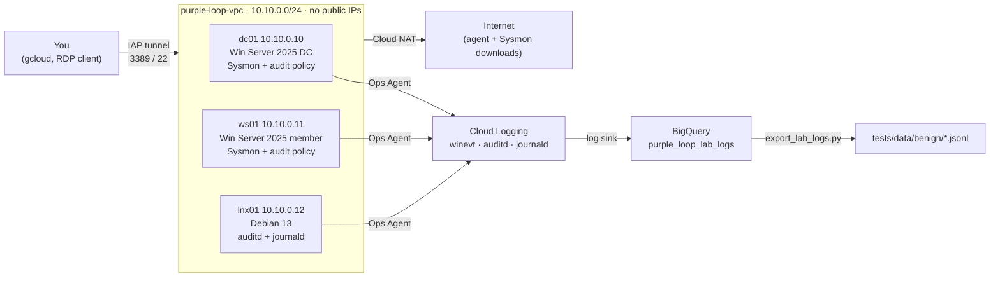

# GCP detection lab runbook

How to build, use, export from, and tear down the Purple Loop lab in
[`infra/terraform/`](../infra/terraform). The lab is **infrastructure and logging only**:
three hosts with Sysmon, Windows auditing, auditd and the Google Cloud Ops Agent, shipping
logs to BigQuery. No attack tooling is installed.



## What it costs

These are rough us-central1 list prices. Check them with the
[Google Cloud pricing calculator](https://cloud.google.com/products/calculator) before you rely on them.

| Item | Running | Stopped |
|---|---|---|
| dc01, ws01: e2-standard-2 + Windows Server license | ~$0.16/hr each | $0 |
| lnx01: e2-small | ~$0.02/hr | $0 |
| Cloud NAT gateway | ~$0.004/hr + $0.045/GB processed | $0 |
| Boot disks (2 × 50 GB + 20 GB pd-balanced) | ~$12/month | ~$12/month |
| Logging, BigQuery, Secret Manager | usually within free tiers at lab volume | ~$0 |
| **Total** | **~$0.35/hr** while running | **~$12/month** stopped |

Safeguards:
- All VMs stop every night at 22:00 in `time_zone` (`schedule.tf`). There is no automatic start.
- Budget emails go out at 50%, 90% and 100% of `monthly_budget`, and when the month-end forecast passes 100%. **A budget does not stop spending.**
- BigQuery partitions expire after 30 days.
- When you're finished, run `terraform destroy` (see [Tear down](#tear-down)). Destroying removes the disk cost too.

## Prerequisites

1. **A dedicated GCP project** with billing linked. Use a project you can delete; don't share it with anything else.
2. **Permissions:** Owner on the project, and on the billing account either *Billing Account Costs Manager* or *Billing Account Administrator* (to create the budget).
3. **Terraform 1.15 or newer**: `terraform version`.
4. **Google Cloud CLI**: install it from <https://cloud.google.com/sdk/docs/install>, then:
   ```bash
   gcloud auth login
   gcloud auth application-default login     # credentials Terraform and the export script use
   gcloud config set project YOUR_PROJECT_ID
   gcloud auth application-default set-quota-project YOUR_PROJECT_ID
   # One-time bootstrap: Terraform needs these two APIs to look up the project
   # before it can enable the rest itself (apis.tf).
   gcloud services enable cloudresourcemanager.googleapis.com serviceusage.googleapis.com
   ```
5. **An RDP client** (Windows: built-in `mstsc`).
6. **Not on the Free Trial.** Free Trial billing accounts can't create Windows Server VMs.
   Upgrading keeps any unused trial credit.

## Deploy

```bash
cd infra/terraform
cp terraform.tfvars.example terraform.tfvars    # gitignored; fill in project, billing account, email
terraform init
terraform plan -out lab.tfplan                  # review: about 35 resources, no public IPs
terraform apply lab.tfplan
```

`terraform apply` finishes in a few minutes. The hosts keep configuring themselves after that:

| Host | Bootstrap | Ready after |
|---|---|---|
| dc01 | Sysmon, audit policy, Ops Agent, then promotion to a new forest (reboots) | ~15 min |
| ws01 | Sysmon, audit policy, Ops Agent, waits for the DC, then joins the domain (reboots) | ~20–25 min |
| lnx01 | auditd rules, Ops Agent | ~3 min |

To watch a host's progress (the startup script writes its output to the serial port):

```bash
gcloud compute instances get-serial-port-output dc01 --zone us-central1-a | grep -iE "bootstrap|sysmon|ops agent|DC:|Member:"
```

Each Windows host also keeps a full transcript in `C:\ProgramData\PurpleLoop\bootstrap.log`.
On Linux it's `/var/log/purple-loop-bootstrap.log`.

## Connect

`terraform output` prints ready-made commands.

**Windows (RDP over IAP).** Leave the tunnel running in one terminal:

```bash
gcloud compute start-iap-tunnel dc01 3389 --local-host-port=localhost:33891 --zone us-central1-a
```

Then connect your RDP client to `localhost:33891` (ws01 uses `33892`). Log in as `PLLAB\Administrator`.
To get the password:

```bash
gcloud secrets versions access latest --secret=purple-loop-domain-admin
```

**Linux (SSH over IAP, OS Login):**

```bash
gcloud compute ssh lnx01 --tunnel-through-iap --zone us-central1-a
```

## Check that logs arrive

In **Logs Explorer**, run:

```
logName="projects/YOUR_PROJECT_ID/logs/winevt"
```

You should see Security, System, Sysmon and PowerShell events from dc01 and ws01. For Linux, use the
`auditd` and `journald` log names.

In **BigQuery**, the sink creates the tables a few minutes after the first matching entry arrives:

```bash
bq query --use_legacy_sql=false \
  'SELECT REGEXP_EXTRACT(jsonPayload.raw_xml, r"<EventID[^>]*>(\d+)<") AS event_id, COUNT(*) AS n
   FROM `YOUR_PROJECT_ID.purple_loop_lab_logs.winevt`
   WHERE timestamp > TIMESTAMP_SUB(CURRENT_TIMESTAMP(), INTERVAL 1 HOUR)
   GROUP BY event_id ORDER BY n DESC'
```

To spot-check the audit settings on a Windows host:

```powershell
auditpol /get /subcategory:"Process Creation","Kerberos Service Ticket Operations"
Get-Service Sysmon64, google-cloud-ops-agent
```

## Export baseline into tests/data

Lab exports are **benign baseline**, and the script only writes under `benign/`.

```bash
uv sync --group lab                              # adds google-cloud-bigquery (not used in CI)
uv run --group lab python scripts/export_lab_logs.py \
  --project YOUR_PROJECT_ID \
  --since 2026-10-15T09:00:00Z --until 2026-10-15T10:00:00Z \
  --event-id 1 --event-id 10 --event-id 13 --event-id 4688 --event-id 4698 --event-id 4769 --event-id 7045 \
  --why "One hour of idle DC and member-server activity after a fresh build."
```

The script:
1. Queries the `winevt` table for that window. The query is parameterized and refuses to scan more than 1 GB.
2. Parses each event's raw XML into the repo's flat schema, filters it by event ID and host, and removes duplicates.
   It also keeps at most 5 events of the same activity per host (`--max-per-pattern`), because a
   fresh Windows host repeats some background work hundreds of times.
3. Writes `tests/data/benign/lab_baseline.jsonl` (change this with `--output`).
4. Appends a `manifest.yaml` entry (`origin: self-generated`) if the file doesn't have one yet.

Then run the detection tests:

```bash
uv run python scripts/run_sigma_tests.py
uv run pytest
```

**If a rule fires on lab baseline, it's a false positive.** Fix the rule or document the exclusion.
Don't delete the event. That loop is the reason for the lab.

Before committing, read through the exported file. It holds only lab hostnames and accounts, but
checking it is a good habit, and the pre-commit secret scan runs either way.

## Cloud audit logs: simulate and export

The GCP rules are tested on the project's own Cloud Audit Logs, which need no VMs running.
The sink also routes them to BigQuery (`cloudaudit_googleapis_com_*` tables, and the
flattened `audit_events` view the hunts read).

```bash
# 1. Perform each risky admin action once and undo it (about a minute):
uv run python scripts/simulate_gcp_audit_events.py --project YOUR_PROJECT_ID --yes
# 2. Export the printed window: one file per rule under malicious/<rule>/, then the
#    benign baseline with --exclude-malicious (see docs/gcp_detections.md for the filters):
uv run --group lab python scripts/export_audit_logs.py --help
# 3. Test, and run the GCP hunts on the real logs:
uv run python scripts/run_sigma_tests.py
uv run --group lab python scripts/run_hunts.py --bigquery YOUR_PROJECT_ID
```

The export replaces your email and IP address with reserved example values before writing,
but read the files before committing anyway.

## Daily use

```bash
# Start the DC first so DNS and authentication are up when the member boots.
gcloud compute instances start dc01 --zone us-central1-a
gcloud compute instances start ws01 lnx01 --zone us-central1-a

# Stop by hand (the nightly schedule does this anyway).
gcloud compute instances stop dc01 ws01 lnx01 --zone us-central1-a
```

The startup scripts run again on every boot. They only re-apply configuration and make no other changes.

## Change or upgrade

- **Sysmon or its config:** download the new file, compute its SHA-256, and update `sysmon_zip_sha256`,
  or `sysmon_config_url` and `sysmon_config_sha256`, in `variables.tf`. Apply, then reboot the Windows
  hosts. A host whose hash doesn't match refuses to install the file and logs a clear error.
- **Rotating the lab passwords:** increase `secret_data_wo_version` in `secrets.tf` and apply. This
  writes a new secret version. The domain Administrator password on the DC is *not* changed
  automatically after promotion, so change it there too, or rebuild the lab.

## Tear down

```bash
cd infra/terraform
terraform destroy
```

This removes the VMs, disks, network, NAT, secrets, sink, BigQuery dataset (including its logs)
and the budget. It leaves the enabled APIs alone. If the project exists only for this lab,
deleting the whole project is cleaner still: `gcloud projects delete YOUR_PROJECT_ID`.

## Troubleshooting

| Symptom | Cause / fix |
|---|---|
| `apply` fails granting `roles/compute.instanceAdmin.v1` to `service-…@compute-system` | The Compute Engine service agent is created a minute after the API is enabled. Run `terraform apply` again. |
| `apply` fails on `google_billing_budget` with 403 | Your account lacks a billing-account role (see Prerequisites), or `budget_currency` doesn't match the billing account. |
| ws01 never joins the domain | Check dc01 first: `Get-Service NTDS, DNS` on dc01. ws01 retries for about 45 minutes per boot, so reboot it once the DC is healthy. |
| No `winevt` table in BigQuery | Tables appear only after the first log entry arrives. Check the Ops Agent on the host (`Get-Service google-cloud-ops-agent*`) and the sink's writer permission on the dataset. |
| `google_bigquery_table.audit_events` fails: no table matches `cloudaudit_googleapis_com_*` | The sink creates the audit tables when the first entry arrives, usually a minute after the first apply. Run `terraform apply` again. |
| IAP tunnel error 4033 | Your account needs `roles/iap.tunnelResourceAccessor` (add it to `iap_members`), or the VM is stopped. |
| Bootstrap log says "Hash mismatch" | An upstream file changed. Review the new version, then update the pinned hash (see *Change or upgrade*). |

## Security notes

- No VM has a public IP. RDP and SSH are allowed only from Google's IAP range (`35.235.240.0/20`).
- The VMs run as a dedicated service account that can only write logs and metrics and read the two lab secrets.
- Lab passwords exist only in Secret Manager. They are written through a Terraform write-only argument, so they are **not** in `terraform.tfstate`.
- `terraform.tfvars`, state files and plans are gitignored. gitleaks runs on every commit.
- Shielded VM (Secure Boot, vTPM, integrity monitoring) is on. The serial console is disabled, and OS Login is enforced for SSH.
